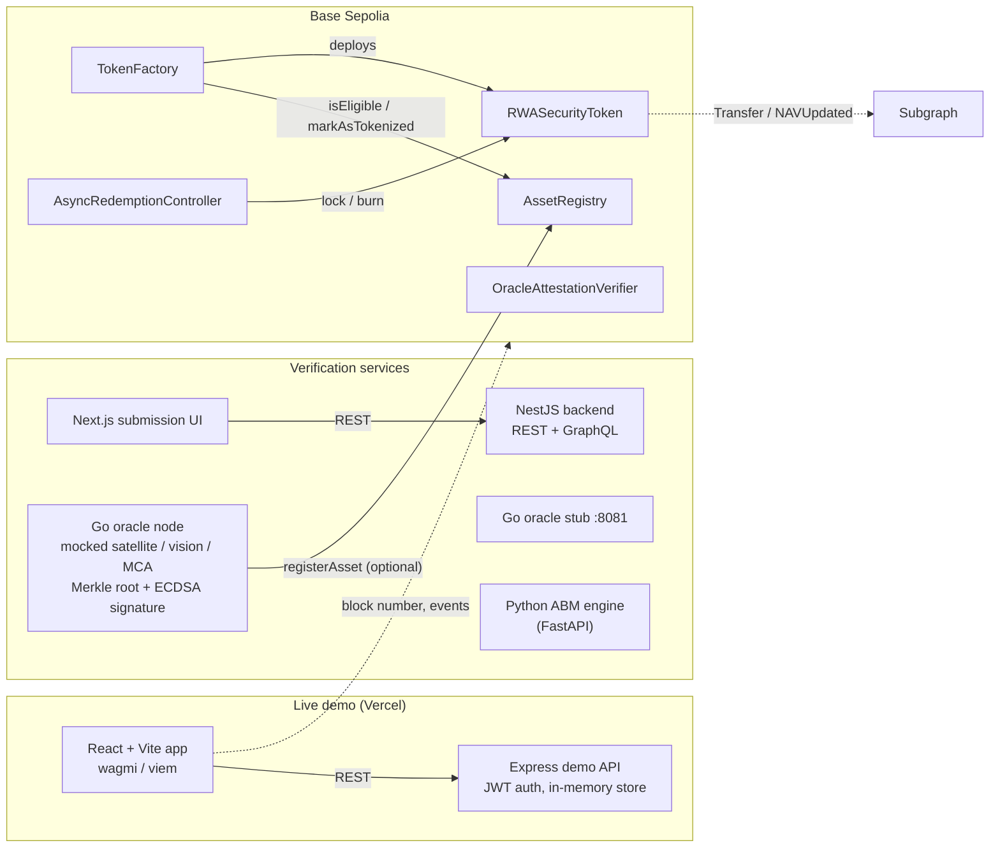

# PropToken

Real-world-asset (RWA) tokenization prototype: an asset is submitted, scored by an off-chain verification pipeline, recorded in an on-chain registry, and issued as a permissioned security token with an asynchronous redemption flow.

**Block 2026 Hackathon, IIT Kharagpur: winner of the Streaming Utility Track and overall Runner-Up.**

[](https://github.com/monickverma/proptoken2/actions/workflows/ci.yml)

- **Live demo:** https://proptoken2.vercel.app (React app + demo API on Vercel; API data is in memory and resets)
- **Contracts on Base Sepolia:** [AssetRegistry](https://sepolia.basescan.org/address/0x61bfab5D232429512c4D183a05Ec22F7e64B1562), [RWASecurityToken](https://sepolia.basescan.org/address/0x2feD68a1B753395d1BD4899438d9A37A21176cC4)

## What's in the repo

| Part | Path | Stack | What it does |
|---|---|---|---|
| Smart contracts | `proptoken-autonomous/contracts/src` | Solidity 0.8.20, Foundry, OpenZeppelin 5.5 | Asset registry, ERC-3643-style security token, token factory, ERC-7540-style async redemption, Merkle attestation verifier. 23 Foundry tests. |
| Deployed snapshot | `proptoken-autonomous/contracts/contracts` | Hardhat | The sources that were deployed to Base Sepolia (see [Deployments](#deployments)). |
| Oracle node | `oracle-network/` | Go, go-ethereum | HTTP `/verify`: runs existence + ownership checks, commits to each signal as a leaf of a keccak256 Merkle tree, returns an inclusion proof per signal, signs the root with secp256k1 ECDSA, and can push the result to `AssetRegistry.registerAsset`. |
| Oracle stub | `proptoken-autonomous/oracle-network/` | Go (stdlib) | Fixed-score `/verify/{existence,ownership,activity}` endpoints, started by Docker Compose. The current submission flow doesn't call it. |
| Verification backend | `proptoken-autonomous/backend` | NestJS, GraphQL (Apollo) | REST `POST/GET /submissions`: weighted heuristic scoring in-process and a keccak256 asset fingerprint. GraphQL market queries. |
| Submission UI | `proptoken-autonomous/frontend` | Next.js 16 | Asset submission form and verification progress page for the backend. |
| Main web app | repo root (`App.tsx`, `pages/`, `components/`) | React, Vite, wagmi/viem | The live demo: investor/issuer dashboards, fractional purchase, swap, yield, verification views. Wallet connection on Base Sepolia. |
| Demo API | `src/`, `api/index.ts` | Express, JWT, zod | Auth, assets, wallet ledger and ABM routes behind the live demo (in-memory store). |
| ABM engine | `proptoken-autonomous/abm-engine` | Python, FastAPI | Rule-based fraud and market-intelligence heuristics (mock comparables). |
| Subgraph | `subgraph/` | The Graph | Schema and mappings for token transfers and NAV updates (not deployed; see limitations). |

## Architecture



## Smart contracts

All in `proptoken-autonomous/contracts/src`, using OpenZeppelin `AccessControl` and `ReentrancyGuard`.

| Contract | Purpose | Roles |
|---|---|---|
| `AssetRegistry` | Stores one record per asset fingerprint: oracle attestation root, ABM output hash, existence/ownership/fraud scores (1e18 scale), risk score, eligibility, mock flag, token address. Fingerprints starting with `"test"` are flagged as mock assets. | `CONSENSUS_ROLE` registers and updates assets; `DEFAULT_ADMIN_ROLE` marks them tokenized |
| `RWASecurityToken` | ERC-20 with ERC-3643-style transfer rules: verified-investor whitelist, frozen wallets, pause, investor cap, forced transfer, NAV and NAV per token. | `MINTER_ROLE`, `COMPLIANCE_ROLE`, `AGENT_ROLE`, `DEFAULT_ADMIN_ROLE` |
| `TokenFactory` | Deploys a token only for an eligible, untokenized registry asset, marks it tokenized, hands the token roles to the caller and renounces its own. | `FACTORY_ROLE` |
| `AsyncRedemptionController` | ERC-7540-style request → approve → settle (burn) / cancel (return) flow for illiquid assets; payout happens off-chain. | `OPERATOR_ROLE` |
| `OracleAttestationVerifier` | Stores attestation Merkle roots and verifies one oracle signal against a root: it recomputes the leaf from the signal's fields and checks the proof with OpenZeppelin `MerkleProof` (sorted-pair keccak256). | `ORACLE_ROLE` (granted/revoked via `authorizeOracle`) |

"ERC-3643-style" and "ERC-7540-style" mean the contracts follow those standards' ideas; they do not implement the full interfaces (no ONCHAINID identity registry, no ERC-4626 vault).

### Deployments

Base Sepolia (chain ID 84532), deployed January 2026 with Hardhat from `contracts/contracts/`:

| Contract | Address |
|---|---|
| AssetRegistry | [`0x61bfab5D232429512c4D183a05Ec22F7e64B1562`](https://sepolia.basescan.org/address/0x61bfab5D232429512c4D183a05Ec22F7e64B1562) |
| RWASecurityToken ("PropToken RWA Test", PRWA) | [`0x2feD68a1B753395d1BD4899438d9A37A21176cC4`](https://sepolia.basescan.org/address/0x2feD68a1B753395d1BD4899438d9A37A21176cC4) |

The deployed bytecode matches the Hardhat sources in `contracts/contracts/` (checked with metadata stripped). That snapshot predates the fixes in `src/`: its `AssetRegistry` uses an `ORACLE_ROLE` + `verifyAsset` flow instead of `CONSENSUS_ROLE`. `TokenFactory`, `AsyncRedemptionController` and `OracleAttestationVerifier` are not deployed.

## Running it

Prerequisites: Node.js 20+, Go 1.25+, [Foundry](https://getfoundry.sh), Python 3.11+ (ABM engine only). Copy each `.env.example` to `.env` where you need one; nothing requires real keys to run locally.

```bash
git clone --recursive https://github.com/monickverma/proptoken2.git
cd proptoken2
```

**Contracts**

```bash
cd proptoken-autonomous/contracts
forge build
forge test -vvv
```

If you cloned without `--recursive`, run `git submodule update --init --recursive` first.

**Main web app + demo API** (what the live demo runs)

```bash
npm ci
npm run dev            # Express API on :3002
npm run dev:frontend   # Vite app on :3003, proxies API routes to :3002
```

Set `JWT_SECRET` for anything beyond local use. Without it the API uses a random per-process secret in development and refuses to issue tokens in production.

**Verification backend + submission UI**

```bash
cd proptoken-autonomous/backend && npm ci && npm run start:dev   # :3001 (REST /submissions, GraphQL /graphql)
cd proptoken-autonomous/frontend && npm ci && npm run dev        # Next.js on :3000
```

**Go oracle node**

```bash
cd oracle-network
go run ./cmd/oracle    # :8080, POST /verify
go test ./...
```

Without `ORACLE_PRIVATE_KEY` it signs with a throwaway key generated at startup and stays off-chain. To publish to a registry, set `ORACLE_PRIVATE_KEY`, `BLOCKCHAIN_RPC_URL` and `REGISTRY_CONTRACT_ADDRESS`. The key's address needs `CONSENSUS_ROLE` on a registry built from `src/`.

**Everything with Docker Compose** (backend, ABM engine, oracle stub, Next.js UI)

```bash
cd proptoken-autonomous
docker compose up --build
```

## Limitations

This is a hackathon prototype. In particular:

- **Verification inputs are mocked.** The Go oracle's satellite client only builds a Yandex static-map URL (it never fetches or analyses the image), the vision score is random in 0.85–0.99, and the MCA company check always passes. The NestJS satellite check returns a fixed 0.92 for any valid coordinates. The oracle stub returns fixed scores.
- **The Merkle root is not stored in the verifier automatically.** The Go node builds a keccak256 sorted-pair Merkle tree over its signals (one leaf per signal: `keccak256(bytes.concat(keccak256(abi.encode(submissionId, category, signal, source, score))))`, the OpenZeppelin `StandardMerkleTree` encoding) and `/verify` returns a proof for each signal. `OracleAttestationVerifier.verifyOracleResult` recomputes that leaf on-chain and checks the proof; `test/Contracts.t.sol` checks a vector generated by the Go code. But the node pushes the root to `AssetRegistry.registerAsset`, not to the verifier, so someone with `ORACLE_ROLE` still has to call `storeAttestation`. Leaves commit to each signal's name, source and score (rounded to 6 decimals, 1e18 scale), not to its raw data or timestamp.
- **Oracle signatures are not checked on-chain.** The node signs its commitment with ECDSA, but the contracts authorise oracles by role (`msg.sender`), not by recovering a signature.
- **The Go oracle node targets the `src/` registry ABI**, not the older deployed one, so pushing to the current Base Sepolia registry would revert until `src/` is redeployed.
- **The demo API and NestJS backend keep data in memory**, and market data on the GraphQL API (`tokens`, `orderBook`, `recentTrades`) is mock data. The GraphQL mock-SPV mutations in `src/api/mutation.resolver.ts` and `MOCK_SPV_FLOW.md` are not registered in a Nest module yet.
- **KYC is a whitelist** (`verifyInvestor`), not an identity registry.
- **The subgraph is not deployable as-is:** `subgraph.yaml` points at a local Hardhat address and the ABI file it references isn't committed.

## License

MIT
